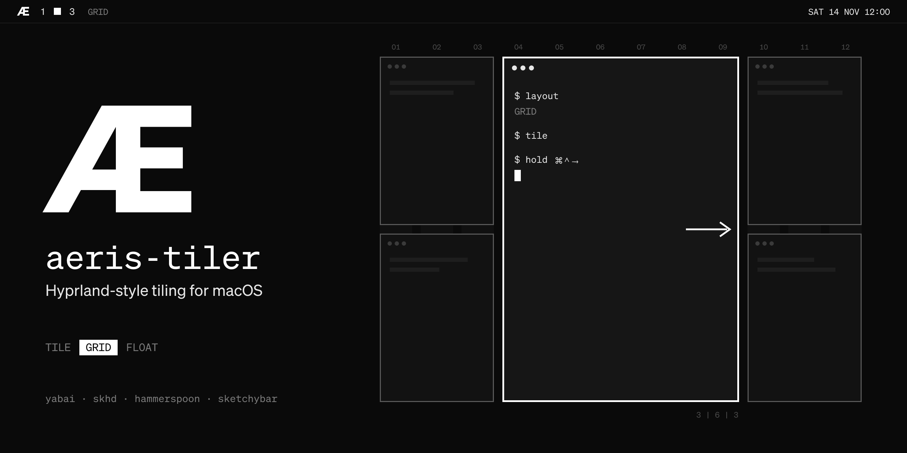

# aeris-tiler



Hyprland-style tiling for macOS in one native app. It tiles windows, handles the hotkeys and the mouse, draws the focus border and shows a searchable cheat sheet. It replaces the earlier setup of yabai, skhd, Hammerspoon, jq and JankyBorders, which is in the git history before this version.

It works with System Integrity Protection (SIP) on and needs one permission: Accessibility. Switching spaces uses macOS's own keys: ⌃← / ⌃→.

## Layouts

Each space has its own layout. ⌘⌥← cycles them; the menu bar icon shows the current one.

| Layout | What it does |
|---|---|
| TILE | Like Hyprland dwindle: a new window splits the focused one along its longer side. Moving a border resizes the neighbours. |
| GRID | A preset places the windows from their count. **Hard**: sizes are locked, a resize shakes the window. **Soft**: borders move, until the windows on the space change. |
| FLOAT | Plain macOS: windows stay where you put them. |

Grid presets (⌃⌥G cycles them, ⌃⌥H toggles hard / soft):

| Preset | Arrangement | Good for |
|---|---|---|
| Swiss | 12 columns: 1 window full, 2 halves, 3 or more in 3 \| 6 \| 3 | Main work in the middle, references at the sides |
| Columns | Equal columns | Comparing documents |
| Main | One window on two thirds, the rest stacked beside it | Focus work |
| Board | Even rows and columns | Overview of many windows |

## Keys

Every key can be changed in Preferences → Shortcuts. ⌘K lists the current ones.

| Keys | Action |
|---|---|
| ⌃⌥ ← → ↑ ↓ | Focus the window in that direction |
| ⌃⌥⌘ ← → ↑ ↓ | Swap with the window in that direction |
| ⌃⌘ ← → ↑ ↓ | Move a border: hold to keep moving, tap for 60 px |
| ⌘⌥← | Cycle layout: tile → grid → float |
| ⌃⌥G / ⌃⌥H | Next grid preset / grid hard or soft |
| ⌃⌥J / ⌃⌥B | Flip a split between columns and rows / balance all splits |
| ⌘⌥↑ / ⌘⌥↓ | Maximize or restore / float or unfloat |
| ⌘⌥→ | Move the window to the other display |
| ⌃⌥⌘ 1–9 | Move the window to space 1–9 and follow it |
| ⌃⌥⇧ ← → ↑ ↓ | Snap to the left, right, top or bottom half |
| ⌃⌥⇧ U I J K | Snap to a quarter |
| ⌃⌥⇧ D F G / E T | Snap to a third / two thirds |
| ⌃⌥⇧ C / ⌃⌥⇧ ↩ | Centre / fill the screen |
| ⌃⌥P | Pause or resume tiling |
| ⌘K | Keysheet: a searchable list of these keys |

A snapped window leaves the layout and floats; ⌘⌥↓ puts it back.

Mouse: ⌃ + drag moves a window (drop it on another tiled window to swap them), ⌃ + right-drag resizes it. Focus follows the mouse without raising the window. New windows open on the display under the mouse. Selecting text copies it; right-click in the text field you type in pastes (⌥ + right-click for the normal menu). Each of these has a switch in Preferences → Mouse.

## Install

Needs macOS 14 or later and the Xcode Command Line Tools. Built and tested on macOS 27.

```bash
git clone https://github.com/hjbarraza/aeris-tiler && cd aeris-tiler
./build.sh cert   # once: a local signing certificate, so the permission survives rebuilds
./build.sh run    # build, install to ~/Applications/Aeris Tiler.app, start
```

Then turn on **Aeris Tiler** in System Settings → Privacy & Security → Accessibility. If yabai, skhd, Hammerspoon or borders still run, stop them first: two window managers fight over the windows.

## Preferences, menu bar, command line

- **Menu bar**: the icon is a small drawing of the current layout: solid windows for tile and a hard grid, outlines for a soft grid and float, dimmed while paused. Its menu has every action, the presets, and Preferences.
- **Preferences**: gaps, padding, default layout and preset, mouse behaviour, border width (0 = none) and colour, shortcuts, floating apps, launch at login.
- **Languages**: English, Spanish, French and German. The app follows the system language; Preferences → General can set one. Translations live in `Sources/TilerCore/Strings.swift`, one row per text.
- **Config file**: `~/.config/aeris-tiler/config.json`. Preferences writes it; after an edit by hand run `aeris-tiler reload`. Keys left out keep their default.
- **Command line**: `aeris-tiler` talks to the running app, so scripts and agents can do all that the GUI can.

```bash
aeris-tiler actions              # every action id with its key
aeris-tiler snap-left-half       # run any action on the focused window
aeris-tiler space-2 --window 42  # or on a window by id (ids come from `query`)
aeris-tiler set preset main      # layout tile|grid|float · preset swiss|columns|main|board · hard true|false · login true|false
aeris-tiler query                # JSON: screens, layouts, windows, frames
```

## What is in here

| Path | Job |
|---|---|
| `Sources/TilerCore/` | Layout maths (tile tree, grid presets, snap positions) and the config. No window APIs; unit-tested. |
| `Sources/AerisTiler/WindowManager.swift` | Reads the windows, keeps one layout per space, places windows through Accessibility. |
| `Sources/AerisTiler/Hotkeys.swift`, `MouseTap.swift`, `Border.swift` | Global hotkeys, mouse behaviour, focus border. |
| `Sources/AerisTiler/Preferences.swift`, `StatusMenu.swift`, `Keysheet.swift` | Preferences window, menu bar menu, ⌘K cheat sheet. |
| `Sources/AerisTiler/main.swift` | App start, command line, app icon. |
| `Sources/CPrivate/` | The private window-server calls: window ids, reading spaces, focus without raise, border stacking. |
| `build.sh` | Build, bundle, sign, install. `swift test` runs the unit tests. |

## Limits

- **Move window to space 1–9 (⌃⌥⌘ 1–9)** needs the macOS shortcuts "Switch to Desktop 1…9" turned on (System Settings → Keyboard → Keyboard Shortcuts → Mission Control). The window server refuses a direct move with SIP on, so the app does what a hand does: it holds the window by its title bar and switches space. It takes about 2 s, the pointer jumps to the window and back, and you follow the window. Keep the mouse still meanwhile. Without the shortcut, or for a space on another display that is not showing, the app beeps.
- No window animations and no instant space switch: both need SIP off.
- Apps have a minimum size. A resize stops when a neighbour reaches its minimum.
- Resizing goes through Accessibility, one app at a time, so it is not as smooth as Hyprland.
- The app uses private macOS calls (see `Sources/CPrivate`), so a macOS update can break parts of it and it cannot go on the Mac App Store.

## Credits

Focus without raise follows the method of [yabai](https://github.com/asmvik/yabai) (MIT). The app has no dependencies besides macOS.
